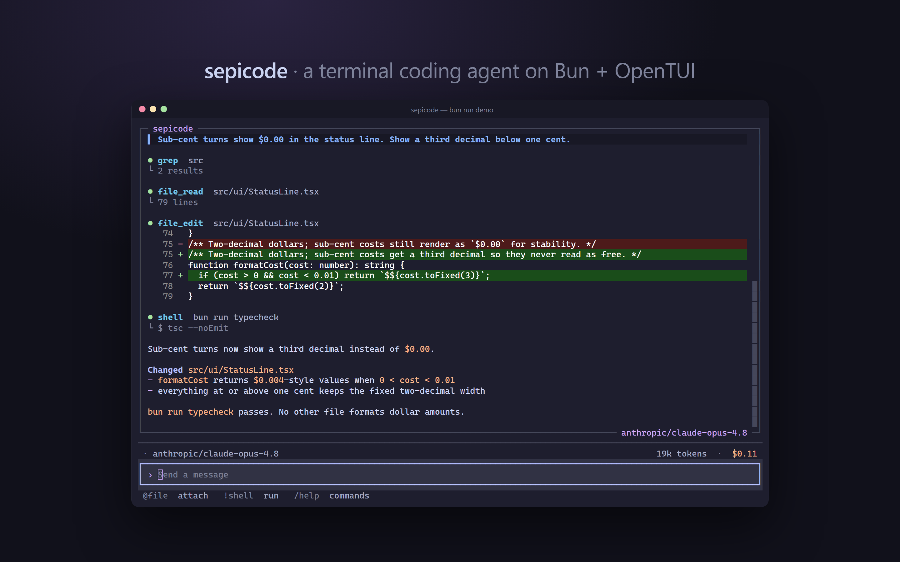
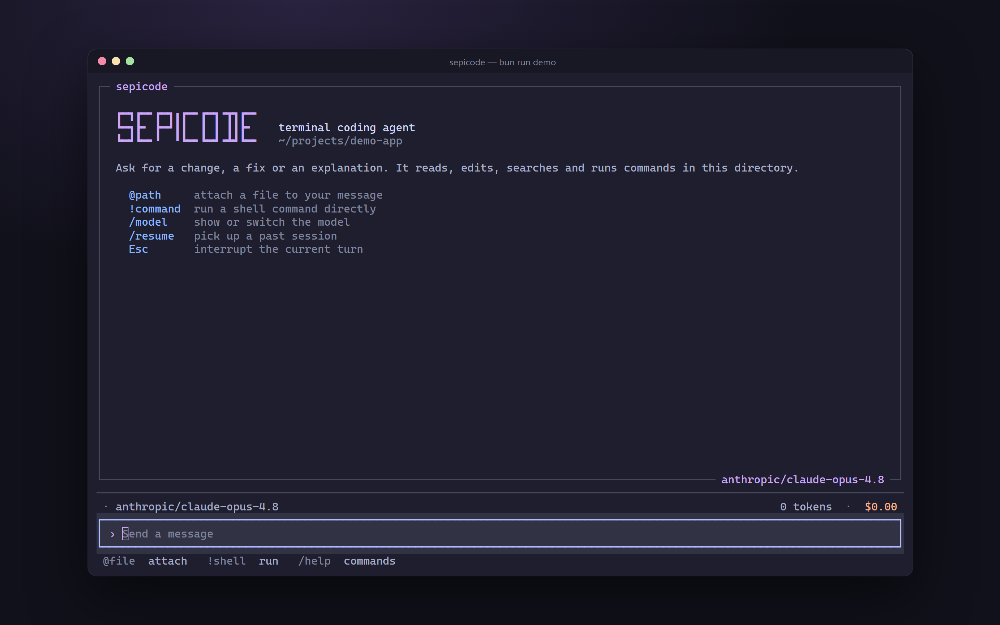
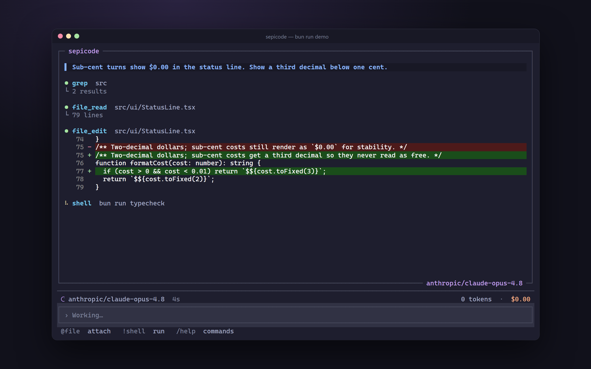
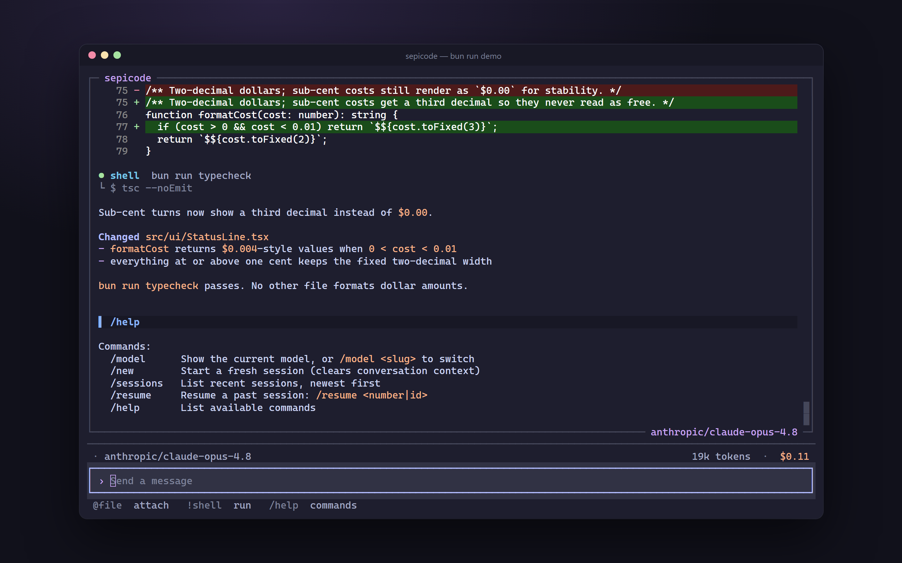
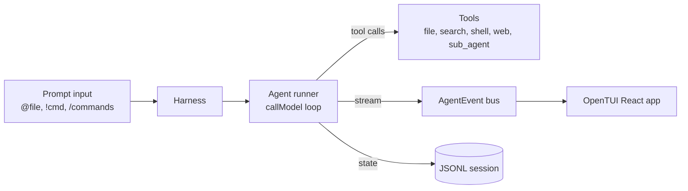

# sepicode



**A full-screen terminal coding agent that reads, edits, searches and runs your code, with hard step and dollar caps on every turn.**


A terminal coding agent with a full-screen TUI, running on Bun. The agent loop comes from [`@openrouter/agent`](https://www.npmjs.com/package/@openrouter/agent) and the UI is React rendered by [`@opentui/react`](https://www.npmjs.com/package/@opentui/react). Any OpenRouter model works; the default is `anthropic/claude-opus-4.8`.

## Highlights

- Full-screen React TUI: streaming Markdown, live tool-call timeline, inline colored diffs, running token and cost totals.
- Nine tools (files, search, shell, web search, read-only sub-agent) behind zod schemas.
- Every turn capped on steps and USD; Esc interrupts mid-turn.
- Offline demo mode (`bun run demo`) that drives the real UI with a scripted agent, no API key needed.

## Screenshots

All screenshots, including the one at the top, are the real TUI running `bun run demo` (scripted agent, demo data), captured in a PTY and rendered with xterm.js. The working directory shown is a placeholder set by the capture script.

| | | |
|---|---|---|
|  |  |  |
| Welcome screen with input shortcuts | A turn in flight: tool calls stream in, elapsed timer ticks | Slash commands go through the real command handler |

## Why it's interesting

- **Bounded autonomy.** The agent runs full-auto (no approval prompts), so every turn is capped on both step count and spend: `stepCountIs(maxSteps)` plus `maxCost(maxCost)` (`src/agent/runner.ts`).
- **Read-only sub-agent.** `sub_agent` spawns a child agent with only `file_read`, `glob`, `grep` and `list_dir`, and tighter caps (8 steps, $0.25), so delegated investigation cannot modify anything or run away (`src/tools/subagent.ts`).
- **Interruptible turns.** Esc aborts the in-flight turn through an `AbortSignal` passed to the model call; the shell tool kills the whole process tree on timeout.
- **Typed event bus.** The SDK stream is mapped to a small `AgentEvent` union (`src/agent/events.ts`), so the React UI never touches SDK types.
- **Persistent sessions.** Conversations are stored as JSONL and can be resumed; the last model picked with `/model` survives restarts.

## Tools

| Tool | What it does |
|---|---|
| `file_read`, `file_write`, `file_edit` | Read, create, and patch files (edits render as diffs in the TUI) |
| `glob`, `grep`, `list_dir` | Find files, search contents, list directories |
| `shell` | Run a command via `cmd.exe` on Windows or `bash -c` elsewhere; combined stdout and stderr, truncated to 2000 lines / 256 KB, 120 s default timeout |
| `web_search` | OpenRouter's server-side search tool |
| `sub_agent` | Delegate a read-only investigation to a child agent (see above) |

## Cost and step caps

| Variable | Default | Scope |
|---|---|---|
| `SEPICODE_MAX_STEPS` | `20` | Tool-call rounds per turn |
| `SEPICODE_MAX_COST` | `1.0` | USD ceiling per turn |
| Sub-agent (fixed in code) | 8 steps, $0.25 | Per `sub_agent` call |

The status line shows running token and cost totals.

## Context compaction

`src/harness/compaction.ts` implements compaction: once token usage passes 75% of an assumed 200k window, it asks a small model (`anthropic/claude-haiku-4.5`) to summarize the conversation, and any failure falls back to "don't compact". Note: this module is not yet called from the UI or runner, so long sessions are not compacted automatically.

## Architecture



```
src/
  cli.tsx          entry: loads config, wires harness + agent + UI
  config.ts        env -> Config        theme.ts  Catppuccin Mocha tokens
  agent/           runner.ts (loop, stop conditions), events.ts (stream -> AgentEvent), prompt.ts
  tools/           file, search, shell, web, subagent, index (registry, zod schemas)
  harness/         session (JSONL), compaction, commands, input, state
  ui/              App, MessageList, Message, ToolCall, StatusLine, PromptInput
```

Design notes: [`docs/superpowers/specs/2026-06-21-sepicode-coding-agent-tui-design.md`](docs/superpowers/specs/2026-06-21-sepicode-coding-agent-tui-design.md).

## Tech stack

Bun, TypeScript, React 19, OpenTUI, `@openrouter/agent`, zod.

## Getting started

Requires [Bun](https://bun.sh) and an [OpenRouter API key](https://openrouter.ai/keys).

```sh
cp .env.example .env    # then set OPENROUTER_API_KEY
bun install
bun start               # run in a real terminal; it is a full-screen TUI
bun run demo            # offline: real UI, scripted agent, no key or network
```

`scripts/capture-screenshots.cjs` regenerates `docs/images/` from the demo (see its header for the Playwright / node-pty / xterm.js setup).

Usage:

- Type a request and press Enter.
- `@path/to/file` inlines a file into the prompt.
- `!cmd` runs a shell command directly.
- Slash commands: `/model [slug]`, `/new`, `/sessions`, `/resume <number|id>`, `/help`.
- Ctrl+C exits; Up/Down recall history.

## Configuration

All variables are optional except the key. See `.env.example`.

| Variable | Default |
|---|---|
| `OPENROUTER_API_KEY` | required |
| `SEPICODE_MODEL` | `anthropic/claude-opus-4.8` |
| `SEPICODE_SUBAGENT_MODEL` | `anthropic/claude-opus-4.8` |
| `SEPICODE_REASONING_EFFORT` | `medium` (`off` or `none` to disable) |
| `SEPICODE_TEMPERATURE` | `0` (used only when reasoning is off) |
| `SEPICODE_THEME` | `catppuccin-mocha` |
| `SEPICODE_SESSION_DIR` | `~/.sepicode/sessions` |
| `SEPICODE_STATE_FILE` | `~/.sepicode/state.json` |

## Tests

There is no test suite yet. `bun run typecheck` runs `tsc --noEmit`.

Because the agent has unrestricted shell and file-write access and no approval gate, run it only in directories you are comfortable letting it modify.

## License

MIT, see [`LICENSE`](LICENSE).

---

<sub>Built by <a href="https://sepehrradmard.ir">Sepehr Radmard</a> · <a href="https://www.linkedin.com/in/sepehr-radmard/">LinkedIn</a> · <a href="https://github.com/sepehr071">GitHub</a> · more projects on my <a href="https://github.com/sepehr071">profile</a></sub>
